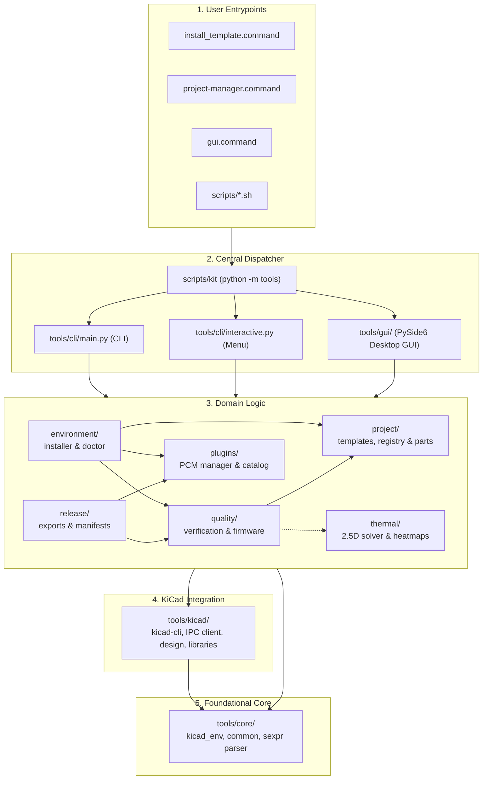

# Architecture

PCB-Project-Template is a local development kit for KiCad **10.0.7** on macOS. It
creates independent board projects from three templates, installs those
templates into KiCad, verifies designs with the real KiCad toolchain and
produces reproducible manufacturing outputs. Logic is Python 3.10+ standard
library except two optional areas: the official `kicad-python` IPC client and
numpy/scipy for the thermal estimate (`tools/thermal/`).

## Layers

```text
 install_template.command   project-manager.command   scripts/*.sh (thin aliases)
            \                       |                        /
             +---------> scripts/kit  =  python -m tools  (.venv or python3 >= 3.10)
                                    |
                     tools/cli/      main.py (non-interactive CLI, exit codes)
                                     interactive.py (menu, same core calls)
                                    |
   +-------------+-------------+----+---------+-------------+-------------+
 environment/   project/      quality/      release/      plugins/      thermal/
 installer      templates     verification  exports       manager       analysis, geometry,
                registry      firmware      packaging     catalog.json  solver, render,
                components         |             |                      compare, config
                     \              |             |              /
                      +------- tools/kicad/ ------------------+
                               cli (kicad-cli), ipc, ipc_client, design, libraries
                                    |
                      tools/core/   kicad_env (all machine paths), common, sexpr
```



Dependencies only point downward, enforced by `test_tools_package_layering`:

| Package | May import |
| --- | --- |
| `core/` | nothing from the kit |
| `kicad/`, `plugins/`, `thermal/` | `core/` |
| `project/` | `core/`, `kicad/` |
| `quality/` | `core/`, `kicad/`, `project/`, `thermal/` (optional gate) |
| `release/` | `core/`, `kicad/`, `quality/` (pre-export verification), `plugins/` (IBOM) |
| `environment/` | `core/`, `kicad/`, `project/`, `quality/`, `plugins/` |
| `cli/` | everything |

All imports are absolute (`tools.<package>.<module>`).

| Module | Responsibility |
| --- | --- |
| `core/kicad_env.py` | Locates KiCad.app, `kicad-cli`, bundled Python, config/documents/template dirs, kit state; resolves `${KICAD10_*}` path variables; detects running KiCad. Every path can be overridden by an environment variable. |
| `core/common.py` | Subprocess records (argv, exit code, output, start time), atomic JSON writes, source hashing, lock-file detection, Git state (read-only). |
| `core/sexpr.py` | Read-only KiCad S-expression parser. Native files are never re-serialized by the kit. |
| `kicad/cli.py` | Version pinning, capability discovery from the installed CLI's `--help`, ERC/DRC with JSON parsing. Unadvertised commands/flags raise exit 15. |
| `kicad/libraries.py` | Library-table resolution (project overrides global; KiCad 10 nested `Table` entries), symbol/footprint existence checks, `${KIPRJMOD}` registration. |
| `kicad/design.py` | Symbols across the schematic hierarchy and board footprints with 3D models. |
| `kicad/ipc.py` / `kicad/ipc_client.py` | IPC configuration and socket diagnostics (stdlib) / `IpcSession` lifecycle and read-only queries (kipy). |
| `project/profiles.py` | Board profiles (`meta/templates/profiles/`): pcbnew-authored defaults with stack-up, rules and net classes; read-back check. |
| `kicad/portability.py` | Detects machine-specific paths in tables, models, sheets and project settings. |
| `kicad/associations.py` | Symbol pin ↔ footprint pad check from library data. |
| `project/templates.py` | Materializes a template into a project tree; used for both `create` and native template installation. |
| `project/registry.py` | Machine-local list of generated projects; KiCad/VS Code launchers. |
| `project/components.py` | Per-part JSON records (manufacturer, MPN, datasheet, symbol, footprint, 3D model, ratings, procurement, approval). |
| `quality/verification.py` | Twelve configurable gates; writes reports under `qa/generated/verification/`. |
| `quality/firmware.py` | Host CMake tests, STM32 preset build, PlatformIO build; missing toolchains reported. |
| `release/exports.py` | Draft and GO exports, IBOM, manifest with raw and normalized hashes, approval binding. |
| `release/packaging.py` | Source ZIP of the kit. |
| `plugins/manager.py` + `catalog.json` | PCM database reading, headless plugin invocation, PCM repository update checks, guided setup, optional offline installers. |
| `environment/installer.py` | Installer and doctor steps with PASS/CHANGED/UNCHANGED/WARN/FAIL/SKIPPED. |
| `thermal/` | `geometry.py` (board parser + rasterizer), `config.py` (inputs), `solver.py` (2.5D finite volume), `render.py` (PNG/HTML), `analysis.py`, `compare.py`; see `docs/THERMAL_ANALYSIS.md`. |
| `cli/main.py`, `cli/interactive.py` | Argument parsing, output formatting and exit codes; the interactive menu. No business logic. |

## Key decisions

- **Two independent KiCad integration layers.** `kicad-cli` handles ERC, DRC and
  all exports headlessly. IPC is optional diagnostics and read-only queries of a
  running editor; nothing in verification or manufacturing depends on it.
- **No invented interfaces.** CLI commands and flags are checked against the
  installed binary's own help (43 commands discovered on KiCad 10.0.7). Plugins
  are invoked through the entry points they ship (IBOM CLI, Freerouting jar,
  `kikit.ui`).
- **Templates are data.** `meta/templates/<id>/template.json` picks a base design,
  firmware overlays and gate overrides; `meta/templates/skeleton.json` lists the
  kit paths every project receives. Kit tooling is not copied into projects;
  projects are operated on by path, so business logic exists once.
- **Official content is referenced, not vendored.** The Arduino Shield base
  design is copied from the installed KiCad's `Arduino_Uno` template at
  generation time, with recorded provenance and a documented 3D-model migration.
- **Fail closed.** Any missing report, unresolved variable, lock file, changed
  source or missing toolchain is a failure with a specific exit code. A GO
  release requires `--authorize`, a bound approval, a clean Git commit and a
  release-mode PASS.
- **Global state stays global.** Plugins remain in KiCad's PCM folders; the venv
  is `.venv` in the kit; the project registry and reports live in
  `~/Library/Application Support/PCB-Project-Template`. Generated projects
  contain none of these.

## Data written outside the repository

| Location | Written by | Content |
| --- | --- | --- |
| `~/Documents/KiCad/10.0/template/<id>/` | `install`, `templates install` | Native templates (+ `meta/kit-template.json` marker) |
| `~/Library/Application Support/PCB-Project-Template/` | registry, reports | `projects.json`, `reports/plugins.json`, `reports/ipc.json` |
| `~/Library/Preferences/kicad/10.0/kicad_common.json` | only `ipc enable --apply` with KiCad closed | `api.enable_server=true` (+ timestamped backup) |

The project-level decision record for board repositories remains in
`docs/project-template/decisions/ADR-0001-repo-boundaries.md` (copied to every
project as `docs/decisions/`).
