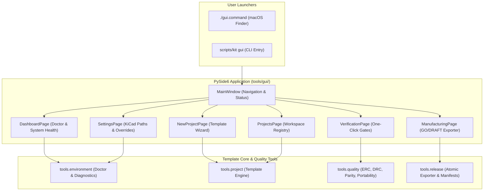

# Desktop-Manager (GUI)

The PCB Project Template includes a native **PySide6 (Qt 6) Desktop GUI** that provides an intuitive, visual control center for all hardware and firmware engineering workflows.

```sh
./gui.command                          # Double-click launcher from Finder
scripts/kit gui                        # Launch via central CLI
scripts/kit gui --project "<path>"     # Launch directly focused on a project
```

---

## Architecture & Integration

The Desktop Manager directly wraps the template's non-blocking Python backend modules, ensuring 100% parity with the command-line interface.



---

## Key Modules & Features

### 1. Dashboard & System Health
- **Live Toolchain Diagnostics:** Displays KiCad version detection (strictly enforcing KiCad 10.0.7), CLI discovery, Python venv status, and Xcode/compiler toolchain readiness.
- **Doctor Integration:** Instant execution of `scripts/kit doctor` with actionable diagnostic badges.
- **Quick Links:** One-click shortcuts to create projects, launch verification, or open the online documentation.

### 2. Projekt-Generator (New Project Wizard)
- **Interactive Template Selection:** Visual selection between `generic-pcb` (2-layer / 4-layer), `stm32-embedded` (4-layer standard stackup), and `arduino-shield`.
- **Destination Validation:** Prevents overwriting non-empty directories and verifies valid project naming.
- **Optional Git Initialization:** Runs `git init` on explicit user request without auto-committing or staging.

### 3. Projekt-Verwaltung (Project Workspace)
- **Project Switcher:** Visual list of recent and registered board projects.
- **Integrity Status:** Real-time display of design lock state (`~*.lck`), modified files, and last verification timestamp.
- **Native KiCad Launch:** Direct button to launch KiCad with the project loaded.

### 4. Verification Runner (Automated Quality Gates)
- **One-Click Execution:** Runs all configured quality gates (`scripts/kit verify`).
- **Visual Status Badges:** Color-coded `PASS`, `ADVISORY`, and `FAIL` chips for each gate:
  - Electrical Rules Check (`erc`)
  - Design Rules & Clearance Check (`drc`)
  - Schematic-to-Layout Parity (`schematic_parity`)
  - Symbol & Footprint Resolution (`library_references`)
  - Portability & Relocatable `${KIPRJMOD}` Paths (`portability`)
  - 3D Model STEP file validation (`models_3d`)
  - Approved Parts & Bill of Materials (`bom`)
- **Direct Log Inspection:** Integrated tabbed output viewer for instant error localization without opening raw terminal windows.

### 5. Fertigungsexport (Manufacturing & Release Engine)
- **Atomic Release Staging:** Exports Gerbers, drill maps, IPC-D-356 netlists, placement files, BOM CSVs, and assembly PDFs.
- **DRAFT vs. GO Mode:**
  - `DRAFT (NO-GO)` for uncommitted internal reviews.
  - `Authorized GO Release` with SHA-256 digital manifest and approval record.
- **Stale & Drift Detection:** Real-time indicator alerting developers if schematics or board layouts were touched after the export was staged.

### 6. Einstellungen & Diagnostik (Settings & Overrides)
- **Custom KiCad Location:** Allows configuring alternative KiCad installation paths or custom CLI binaries (`KICAD_CLI`, `KICAD_APP`).
- **Untested Toolchain Toggle:** Controlled activation of `KICAD_KIT_ALLOW_UNTESTED` for experimental evaluation while keeping GO releases protected.
- **Theme Support:** Clean, native macOS dark and light appearances matching system preferences.

---

## Test Automation & Quality Assurance

The Desktop GUI is covered by a suite of 52 automated headless UI tests located in `qa/tests/test_gui.py`:

```sh
.venv/bin/python3 -m unittest qa/tests/test_gui.py
```

These tests verify tab navigation, form validation, project generation, gate badge updating, and thread safety under PySide6 offscreen testing conditions.
