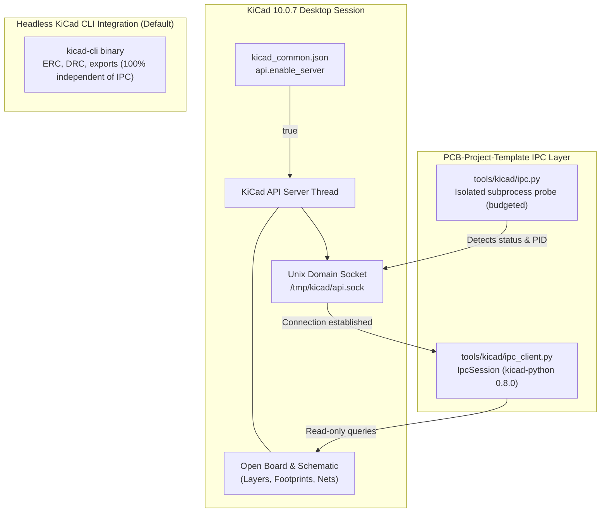

# KiCad IPC API

The IPC layer is optional. ERC, DRC and every export use `kicad-cli` and work
without a running KiCad.

## Components

- `tools/kicad/ipc.py` (stdlib only): reads `api.enable_server` from
  `~/Library/Preferences/kicad/10.0/kicad_common.json`, lists running KiCad GUI
  processes, discovers sockets (`$KICAD_API_SOCKET`, then `/tmp/kicad/api*.sock`),
  finds an interpreter with `kicad-python` (`.venv` first), runs the probe in a
  separate process with a hard time budget, and explains the result.
- `tools/kicad/ipc_client.py` (`kicad-python` 0.8.0): `IpcSession` context manager —
  connect, `ping()` validation, queries, explicit close. Read-only queries:
  server and client API versions, open project/schematic/PCB documents, and for
  an open board: name, footprint, net, track, via and zone counts, copper layer
  count and title block.



## Diagnosis on this machine (2026-10-18)

`scripts/kit ipc status` reported `UNAVAILABLE` with the root cause:

```text
api.enable_server: False (~/Library/Preferences/kicad/10.0/kicad_common.json)
KiCad processes:   7129 (/Applications/KiCad/KiCad.app/Contents/MacOS/kicad)
sockets:           none found      (/tmp/kicad does not exist)
client:            .venv/bin/python (kicad-python 0.8.0)
probe:             ConnectionError: Failed to connect to KiCad: Connection refused
```

KiCad 10 only creates `/tmp/kicad/api.sock` when the API server is enabled. The
earlier "missing socket" problem was therefore a disabled server, not a socket
path mismatch. The setting was **not** changed automatically because KiCad was
running: KiCad rewrites `kicad_common.json` on exit, so editing it underneath a
live session would be lost or would clobber live settings.

## Enabling the API

Either, inside KiCad: **Preferences > Plugins > Enable KiCad API**, then restart
KiCad; or with KiCad closed:

```sh
scripts/kit ipc enable           # dry run: shows the single change
scripts/kit ipc enable --apply   # writes api.enable_server=true, keeps a timestamped backup
```

`enable` refuses with exit 16 while any KiCad GUI process runs and leaves every
other setting unchanged. Then start KiCad, open a board in the PCB Editor and run
`scripts/kit ipc status` again.

## Failure classes

| `error_class` | Meaning |
| --- | --- |
| `connection_failed` | Socket missing/refused or the request timed out (server disabled, KiCad closed, stale socket). |
| `api_error` | Server answered with an API error (for example no board open for board queries). |
| `version_mismatch` | Client/server protocol mismatch (`FutureVersionError`). |
| `client_missing` | `kicad-python` not importable; run the installer. |
| `timeout` / `probe_failed` | The isolated probe exceeded its budget or crashed; stderr is included. |

`scripts/kit ipc status` exits 0 only when connected, 3 otherwise. The JSON
report is saved to `~/Library/Application Support/PCB-Project-Template/reports/ipc.json`.
Plugins launched by KiCad receive `KICAD_API_SOCKET` and `KICAD_API_TOKEN`; the
kit never stores tokens.

References: [IPC API for add-on developers](https://dev-docs.kicad.org/en/apis-and-binding/ipc-api/for-addon-developers/),
[kicad-python](https://pypi.org/project/kicad-python/0.8.0/).
