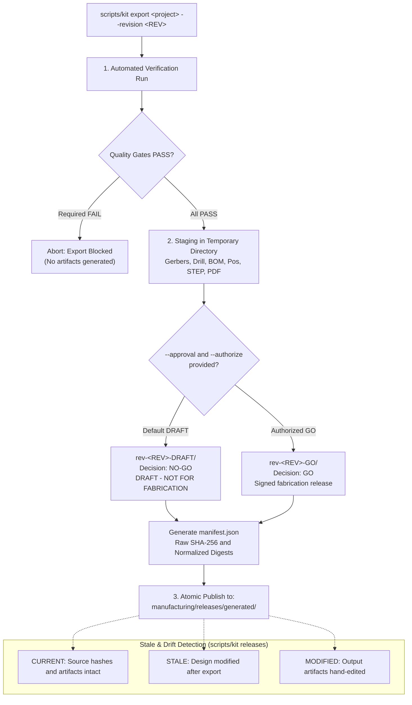

# Manufacturing

```sh
scripts/kit export "<project>" --revision A1                                   # NO-GO draft
scripts/kit export "<project>" --revision A1 --approval approval.json --authorize   # GO release
scripts/kit compare-exports <run1>/manifest.json <run2>/manifest.json
```

Every export first runs verification, then stages all outputs in a temporary
directory and publishes it atomically. An existing revision directory is never
overwritten (exit 21).



## Outputs

`manufacturing/releases/generated/rev-<REV>-DRAFT/` (or `-GO/`):

| Path | Producer (KiCad 10.0.7 unless noted) |
| --- | --- |
| `fabrication/gerbers/` | `pcb export gerbers` (all layers + `*-job.gbrjob`) |
| `fabrication/drill/` | `pcb export drill --format excellon --excellon-units mm --generate-map --map-format pdf` |
| `assembly/bom.csv` | `sch export bom` with fields Refs, Value, Footprint, Qty, DNP, Manufacturer, MPN, Datasheet, grouped by Value/Footprint/Manufacturer/MPN |
| `assembly/positions.csv` | `pcb export pos --format csv --units mm --side both --exclude-dnp` |
| `assembly/assembly-top.pdf`, `assembly-bottom.pdf` | `pcb export pdf` of F.Fab/B.Fab + Edge.Cuts (bottom mirrored) |
| `assembly/ibom.html` | InteractiveHtmlBom CLI with KiCad's Python (`SKIPPED` if not installed) |
| `mechanical/board.step` | `pcb export step --no-dnp` |
| `documentation/schematic.pdf`, `netlist.net` | `sch export pdf`, `sch export netlist --format kicadsexpr` |
| `verification/` | The verification run used for this export |
| `manifest.json` | Revision, decision, Git state, KiCad version and `kicad_version_status`, gate results, every command record, source hashes, artifact SHA-256 and normalized digests, configuration (gate severities, template/profile from `meta/project.json`), designator findings, known limitations |

**Designator consistency** (output `designator_consistency`): BOM references
(ranges expanded), placement-file references, schematic symbols and board
footprints must agree (board-only and `exclude_from_pos_files` footprints are
handled as KiCad does). A mismatch makes the export incomplete and blocks a GO
release.

**Stale artifacts:** `scripts/kit releases "<project>"` compares every export's
manifest with the current sources and files: `CURRENT`, `STALE` (a source file
changed since the export, listed), `MODIFIED` (an artifact was edited, removed
or added), `INCOMPLETE` (no manifest). Only CURRENT packages should be sent to
a fabricator.

A draft is labelled `DRAFT - NOT FOR FABRICATION` with decision `NO-GO`, even
when every gate passes.

## Reproducibility

Exports from unchanged sources are compared by normalized digest:

- Gerber, job, drill, netlist and PDF files: known timestamp fields
  (`%TF.CreationDate`, `G04 ... date`, `"CreationDate"`, `; DRILL file ... date`,
  `(date ...)`, PDF `/CreationDate` and `/ModDate`) are removed before hashing.
- STEP files: OpenCascade renumbers entities between runs, so their digest is an
  entity-type census. This detects geometry/structure changes in practice but
  is weaker than a byte comparison.

Two consecutive exports of the fixture compared identical across all 38
artifacts. Raw SHA-256 values are kept as well, for archiving.

## GO release

A GO release is created only if every condition holds; otherwise nothing is
published and the command exits 22:

1. `--authorize` is given (explicit user authorization), and KiCad is the tested 10.0.7.
2. The project is its own Git repository, clean, with a commit.
3. The approval JSON says `GO`, names the exact revision and commit, an approver,
   an ISO date and a signed checklist, and every gate in `release.GATES`
   (requirements, interfaces, ERC/DRC/netlist review, power/thermal, vendor
   assets, mechanical, fabrication, assembly, firmware interfaces, prototype
   validation) is `PASS` or `NOT_APPLICABLE` with an evidence file inside the project.
4. Verification in release mode passes (advisory gates listed in
   `release_gates` become required).
5. All exports complete, and sources and Git state are unchanged afterwards.

The approval file and every evidence file are copied into the release.
`manufacturing/approval.example.json` is a NO-GO skeleton. The kit checks
bindings and file presence; it cannot check signature authenticity or the truth
of a measurement. A clean ERC/DRC result is not evidence of thermal safety,
electrical correctness or fabrication readiness.
