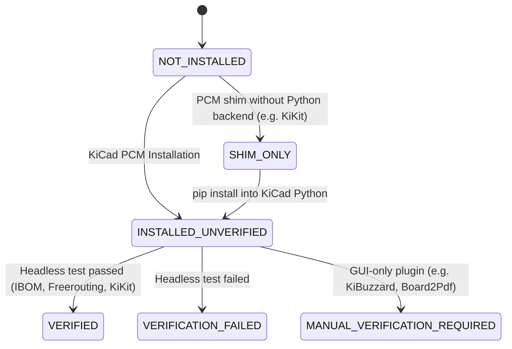

# Plugin management

Plugins stay installed globally (KiCad PCM folders or KiCad's bundled Python);
they are never copied into projects. The catalog is `tools/plugins/catalog.json`; the logic is `tools/plugins/manager.py`.

## Catalog and KiCad 10 compatibility

Compatibility comes from the official PCM repository metadata
(`https://repository.kicad.org/repository.json`, checked 2026-10-18).

| Plugin | Tier | Install method | KiCad 10 compatibility evidence | Headless verification |
| --- | --- | --- | --- | --- |
| InteractiveHtmlBom | required | PCM `org.openscopeproject.InteractiveHtmlBom` | 2.12.0 declares `kicad_version_max` 10 | Generates an HTML BOM from the fixture with KiCad's Python (`generate_interactive_bom.py --no-browser`) |
| Freerouting | required | PCM `app.freerouting.kicad-plugin` | 2.4.1 declares min 6.0, no max; package says "needs Java JRE 25" | Exports Specctra DSN from the fixture (tracks removed) via pcbnew, routes it with the bundled jar (`--gui.enabled=false`), requires an SES with `(wire` entries |
| KiKit | recommended | PCM `com.github.yaqwsx.kikit` (action shim) + `kikit` package in KiCad's bundled Python | 1.6.0 shim declares min 7.0, no max | Panelizes the fixture 2×2 with `python -m kikit.ui panelize` |
| KiBuzzard | recommended | PCM `com.github.gregdavill.KiBuzzard` | 1.7.0 declares min 6.0, no max | GUI-only action plugin: `MANUAL_VERIFICATION_REQUIRED` |
| Board2Pdf | recommended | PCM `com.gitlab.dennevi.Board2Pdf` | 1.9.3 declares `kicad_version_max` 10.0 | GUI-only in this kit: `MANUAL_VERIFICATION_REQUIRED` |
| KiBot | recommended | `pip install kibot` into an interpreter that imports `pcbnew` | Not a PCM package | `python -m kibot --version` with KiCad's Python |
| pcb-action-tools | optional | PCM `com.github.easyw.kicad-action-tools` | 1.0.7 declares min 8.0, no max | GUI-only: `MANUAL_VERIFICATION_REQUIRED` |
| Round Tracks | optional | PCM `com.github.mitxela.kicad-round-tracks` | 1.6 declares min 7.0.1, no max | GUI-only |
| HQ DFM | optional | PCM `com.github.Huaqiu-Electronics.kicad-hqdfm-plugin` | 2.0.11 declares min 9.0, no max | GUI-only; manufacturer-specific rules |

No plugin is required to create, verify or export a project: a missing plugin
is reported (and IBOM output becomes `SKIPPED`), never an error. Each catalog
entry also records `purpose`, `optional_dependencies` and `known_limitations`,
shown by `scripts/kit plugins status --json` and `scripts/kit plugins guide NAME`.

Declared compatibility is metadata, not a runtime guarantee; only the
verification column counts as evidence.

## Status values

| Status | Meaning |
| --- | --- |
| `NOT_INSTALLED` | No PCM database entry with payload, no manual install, no Python package. |
| `INSTALLED_UNVERIFIED` | Installed per PCM database and payload folder; not invoked in this run. |
| `SHIM_ONLY` | PCM shim present but its Python backend is missing (KiKit). |
| `VERIFIED` | Invoked headlessly in this run and produced the expected output. |
| `VERIFICATION_FAILED` | Installed, but the invocation failed (details in the JSON report). |
| `MANUAL_VERIFICATION_REQUIRED` | Installed GUI-only plugin; check it in the PCB Editor. |



## Commands

```sh
scripts/kit plugins status           # static status, PCM database location, Java version
scripts/kit plugins verify           # invoke every installed plugin headlessly (~20 s)
scripts/kit plugins verify freerouting
scripts/kit plugins updates          # compare with the PCM repository (SHA-256 checked index)
scripts/kit plugins guide kibuzzard  # exact guided installation steps
```

Reports are written to `~/Library/Application Support/PCB-Project-Template/reports/plugins.json`.
Exit code 4 means a required plugin is not ready.

## Installation

KiCad's PCM has no command-line interface, so PCM packages are installed via
**KiCad > Plugin and Content Manager**, then **Apply Pending Changes**; restart
the PCB Editor and run `scripts/kit plugins verify NAME`. `guide` prints these
steps per plugin. For pip-based backends (KiKit, KiBot) the guide prints the
exact `pip install --user` command for KiCad's bundled interpreter; the kit
does not run it, because it modifies KiCad's Python environment.

The PCM database is read from `~/Library/Preferences/kicad/10.0/installed_packages.json`.
A stale `~/Documents/KiCad/10.0/3rdparty/installed_packages.json` (present on
this machine with older versions) is ignored and reported as a note.

### Offline alternatives (optional)

- `scripts/kit plugins install-ibom` links a pinned, clean `v2.12.0` checkout
  into `scripting/plugins`. It refuses if PCM already manages IBOM.
- `scripts/kit plugins install-archive NAME --archive FILE --sha256 HASH`
  installs the legacy action-plugin payload of a reviewed PCM ZIP after checking
  the hash, identity, KiCad 10 compatibility, safe paths and entry point. Packages
  with extra payloads must use PCM. Neither command edits PCM's database.

## Use in the pipeline

`scripts/kit export` calls InteractiveHtmlBom headlessly and stores
`assembly/ibom.html`; when IBOM is not installed the output is `SKIPPED` and the
manifest says so. Freerouting is never invoked on user boards automatically.
