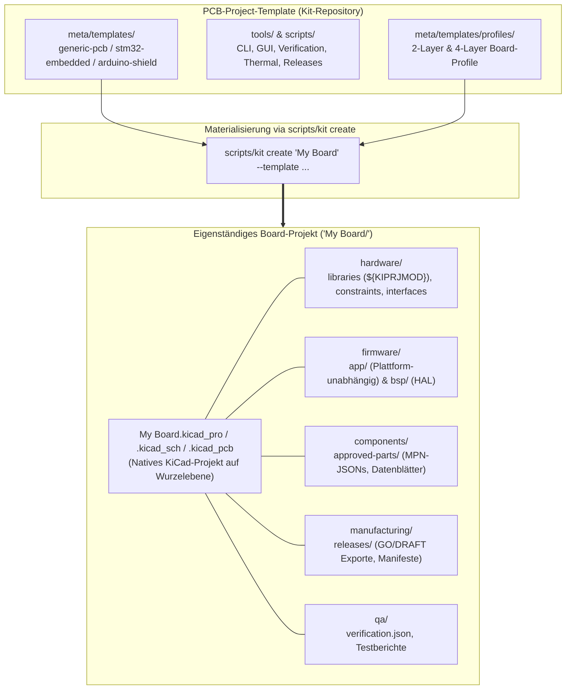

# Project structure

## Kit repository

```text
PCB-Project-Template/
├── AGENTS.md                  rules for agents (projects + kit, Git ownership)
├── LICENSE, README.md
├── requirements.txt           pip deps for .venv (kicad-python, pinned)
├── install_template.command   one-time installer (Finder double-click)
├── project-manager.command    interactive project manager
├── test_template.py           runs the whole test suite
├── hardware/                  native-defaults/ (KiCad 10.0.7 blank files) + project skeleton READMEs/CSVs
├── firmware/                  templates/{common,stm32,arduino}/ overlays + project skeleton READMEs
├── components/                component-record skeleton (approved-parts/, datasheets/, spice-models/, CSVs)
├── manufacturing/             release checklist, approval example, fabrication/assembly READMEs
├── docs/                      kit documentation; project-template/ (project docs); archive/ (superseded)
├── qa/                        tests/, fixtures/divider/, project-template/, design-reviews/, reports/
├── scripts/                   kit (launcher), *.sh aliases, install-kicad.sh
├── tools/                     Python packages: core/ kicad/ project/ quality/ release/ plugins/ environment/ thermal/ cli/
└── meta/                      info.html (original root metadata), templates/ (three templates)
```

Ownership: `hardware/` native files and libraries; `firmware/` firmware
templates, BSPs, drivers; `components/` part data; `manufacturing/` release
procedures and exports; `docs/` documentation; `qa/` verification rules,
fixtures, tests and reports; `scripts/` executables; `tools/` reusable modules;
`meta/` KiCad template metadata. The kit root has no `.kicad_pro`, so KiCad
never sees a competing project.

Generated or local state (ignored by Git): `.venv/`, `qa/generated/`,
`manufacturing/releases/generated/`, `*.kicad_prl`, lock files, backups.

## Generated project

```text
My Board/
├── My Board.kicad_pro / .kicad_sch / .kicad_pcb    native KiCad project (root)
├── fp-lib-table                                    only when the template has local libraries
├── AGENTS.md, README.md                            rendered with the project name
├── .gitignore, .gitattributes
├── hardware/      libraries/{symbols,footprints,3d-models}, interfaces/ (pinmap, power budget),
│                  constraints/, mechanical/, simulations/ (thermal/: thermal.json, power_sources.csv)
├── firmware/      app/, bsp/, drivers/, config/, tests/, tools/  (+ CMake/PlatformIO for MCU templates)
├── components/    approved-parts/*.json, datasheets/, spice-models/, bom_master.csv, sources.csv
├── manufacturing/ approval.example.json, releases/RELEASE_CHECKLIST.md, releases/generated/ (exports)
├── docs/          requirements, architecture, interfaces, bring-up, verification plan, decisions/,
│                  engineering/ (design guidelines, datasheet checklist, lessons learned)
├── qa/            verification.json (gate severities), design-reviews/, reports/, tests/, generated/
└── meta/project.json                                template, kit version, provenance
```



| Template | Differences |
| --- | --- |
| `generic-pcb` | Blank schematic and board from the chosen profile (`2-layer` default, or `4-layer`); `firmware/` holds only guidance READMEs. |
| `stm32-embedded` | Adds `firmware/CMakeLists.txt`, `CMakePresets.json` (`host-tests`, `stm32-debug`), `app/` heartbeat module, `bsp/include/bsp/board_io.h`, `bsp/stm32/`, `tests/`. Firmware gate `advisory`. |
| `arduino-shield` | Base design from KiCad's official `Arduino_Uno` template (outline, headers, mounting holes); `Arduino_MountingHole.pretty` moved to `hardware/libraries/footprints/`; adds `firmware/platformio.ini`, `arduino/main.cpp`, `bsp/arduino/` and the same host tests. |

Projects never contain the kit's `tools/`, `scripts/`, `.venv`, fixtures or
plugins. Run kit commands with the project path, for example
`scripts/kit verify "$HOME/Projects/My Board"`. Creation refuses non-empty
destinations, never merges, and never commits; `--git` only runs `git init`.

Project names: 1–80 characters, ASCII letters/digits first, then letters,
digits, spaces, `_`, `-`, `.`; not ending in `.` or space; no `..`. Paths with
spaces are supported throughout.
