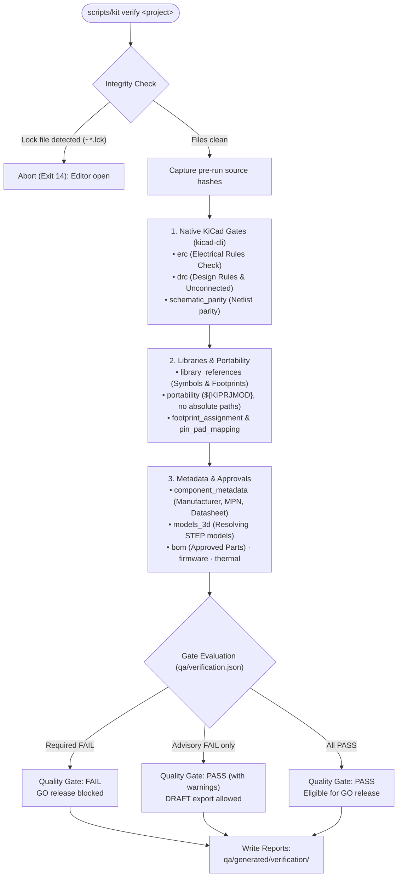

# Verification

## Design quality gates

`scripts/kit verify "<project>"` runs every non-disabled gate. Reports go to
`<project>/qa/generated/verification/<timestamp>-<id>/` (`erc.json`, `drc.json`,
`verification.json`). Design files are only read; source hashes before and
after the run must match, and editor lock files (`~*.lck`) abort with exit 14.

| Gate | Check | Default |
| --- | --- | --- |
| `erc` | `kicad-cli sch erc --severity-all`; any non-excluded error or warning fails; exclusions are listed for review | required |
| `drc` | `kicad-cli pcb drc --severity-all`; violations and unconnected items fail | required |
| `schematic_parity` | `--schematic-parity` findings | required |
| `library_references` | Every symbol `lib_id`, schematic `Footprint` field and board footprint resolves through the project/global library tables to an existing symbol / `.kicad_mod` | required |
| `portability` | No absolute/home-directory paths, user-defined or legacy (`${KICAD9_*}`) variables in library tables, 3D-model paths, sheet files or project settings | required |
| `footprint_assignment` | Every on-board, non-power symbol has a footprint | required |
| `pin_pad_mapping` | Every electrical symbol pin (no-connect pins excepted) has a pad with the same number in the assigned library footprint | required |
| `component_metadata` | Every BOM symbol (not power, not DNP) has `Manufacturer`, `MPN` and a real `Datasheet` | advisory |
| `models_3d` | Every physical footprint has a visible 3D model whose path resolves (`${KICAD10_3DMODEL_DIR}`, `${KIPRJMOD}`, configured paths) to an existing file | advisory |
| `bom` | Every BOM symbol's MPN maps to an `approved` record in `components/approved-parts/` with a matching footprint; all records validate | advisory |
| `firmware` | Firmware host build and unit tests | disabled (`advisory` in MCU templates) |
| `thermal` | Thermal estimate from `hardware/simulations/thermal/` (limits, unknown references, energy balance); see `docs/THERMAL_ANALYSIS.md` | disabled (needs real power data) |

Severities live in `<project>/qa/verification.json` (`required`, `advisory`,
`disabled`). The quality gate is `FAIL` if a required gate is not `PASS`;
advisory failures are listed as warnings. `--release` (and every GO export)
forces all `release_gates` to required. Older KiCad 9 variables such as
`${KICAD9_3DMODEL_DIR}` are deliberately not aliased: `kicad-cli` 10.0.7 does not
resolve them either, so they are reported.

What a PASS means: KiCad's rule checks, library resolution and metadata checks
found nothing. It does **not** establish electrical correctness, thermal
safety, current capacity, EMC behaviour or fabrication readiness. Those need the
reviews and prototype evidence listed in `docs/verification-plan.md` of each
project and in the release approval.

## Component records

`components/approved-parts/<Manufacturer>__<MPN>.json` (created by
`scripts/kit components add`) holds manufacturer, MPN, description, datasheet
(URL, revision, optional local file with SHA-256, retrieval date), KiCad symbol,
footprint, 3D model, SPICE model, ratings with sources, procurement entries
with lifecycle, and approval (`candidate`, `approved`, `restricted`,
`obsolete`, `rejected`). `scripts/kit components validate` checks schema,
https URL or local file, hash, library references, model file, duplicates and
that approved parts carry approver, date, datasheet revision, ratings and
procurement data. Records are never overwritten by the kit.

## Kit test suite

`python3 test_template.py` runs 157 tests (about 2 minutes with KiCad; it switches to
the kit's `.venv`, which provides numpy/scipy for the thermal tests):

| Module | Covers |
| --- | --- |
| `test_layout.py` | Mandatory layout, executables, ownership boundaries, `tools/` package layering, required docs, case-insensitive collisions, preservation of original files (hashes), CSV contracts, docs mention only real CLI commands |
| `test_templates.py` | Invalid names, paths with spaces, all three templates, no leakage of kit files, existing/empty/file destinations, `git init` without commit, registry, Arduino provenance and model migration, KiCad loading, native install idempotency, foreign/modified/outdated templates |
| `test_installer.py` | First and repeated installation (no rewrites), foreign template preservation, missing KiCad abort, read-only doctor, `.command` entrypoint |
| `test_toolchains.py` | Missing / wrong-version `kicad-cli`, capability guard, missing firmware toolchains, Arm toolchain discovery (configured path, standard locations, newest version, PATH untouched), STM32 CMake wiring against a stand-in of CubeMX's package structure, actionable error without CubeMX output, real host builds, relocation, injected firmware defect and compiler warnings; opt-in real STM32 cross-build (`KIT_STM32_CUBEMX_SOURCE`) |
| `test_ipc.py` | Config parsing, refusal while KiCad runs, dry-run/apply with backup, unreachable sockets, missing client, cause analysis, CLI exit code; live test when a server is reachable |
| `test_plugins.py` | PCM status logic, stale database note, never claiming uninstalled plugins, compatibility filter, update check with integrity failure and offline mode, archive installer safety; headless IBOM/Freerouting/KiKit invocation |
| `test_components.py` | Record creation, no overwrite, broken references, hash mismatch, approval evidence, duplicates and invalid JSON |
| `test_verification.py` | Fixture PASS, release-mode blocking, removed track, corrupt schematic, broken library reference, missing footprint/3D model, metadata/BOM pass with approved records and footprint mismatch, lock files |
| `test_manufacturing.py` | Approval binding, normalization, complete and reproducible draft exports, no overwrite, release blocked without authorization / Git / on failed verification, GO path |
| `test_thermal.py` | Analytic solver benchmarks (two-node network, 1D fin, symmetry, isolated island), fixture geometry, outputs, energy balance, grid convergence, limits and θJB, input errors, compare, CLI and gate, pad positions against pcbnew |
| `test_hardening.py` | Board profiles (consistency, pcbnew read-back, rebuild equality, unsupported profiles), portability classification and detection, broken footprint library path, pin without pad, relocation to a path with spaces and non-ASCII characters, missing 3D models reported, untested KiCad version policy and GO block, designator consistency, STALE/MODIFIED/INCOMPLETE exports, configuration files parse, documentation links resolve, malformed ERC/DRC reports |
| `test_manager.py` | Scripted interactive sessions (retry on invalid name, cancel, existing destination, non-project path, EOF), `.command` launcher, CLI exit codes |

Native tests use `qa/fixtures/divider`, a connector and two resistors built only
from KiCad's official libraries by `qa/fixtures/build_fixtures.py` (schematic
symbols copied verbatim; board built with pcbnew). It passes ERC, DRC and
parity with zero findings and exists only to exercise tooling.
