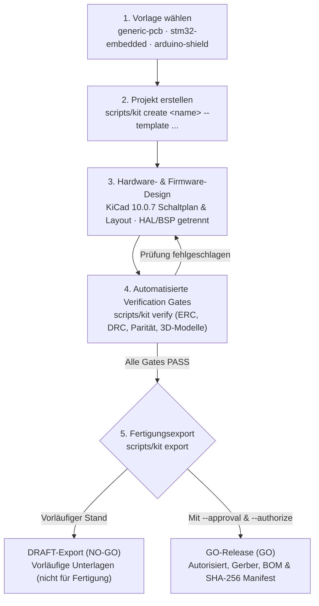

# PCB Project Template – Dokumentation

<div class="kit-hero">
  <p><strong>Ein klarer, reproduzierbarer Start für professionelle Hardware- und Firmware-Entwicklung mit KiCad 10.0.7 auf macOS.</strong></p>
  <p>Verlässliche Projektstruktur, automatisierte Verification Gates (ERC/DRC mit Schaltplan-Parität), autorisierte Fertigungsfreigaben mit SHA-256-Manifesten und Steuerung via CLI (<code>scripts/kit</code>) sowie moderner Desktop-Manager GUI.</p>
  <div class="kit-hero-badges">
    <span class="badge badge-info">KiCad 10.0.7</span>
    <span class="badge badge-info">macOS</span>
    <span class="badge badge-info">Python 3.10+</span>
    <span class="badge badge-go">Release GO / DRAFT</span>
  </div>
</div>

## Willkommen

Das **PCB-Project-Template** ist eine erprobte Entwicklungsvorlage für macOS, die wiederkehrende Aufgaben rund um ein Board an einem Ort zusammenführt:

- **Verlässliche Projektstruktur:** Klare Ablage für Schaltplan, Board, Firmware (HAL/BSP getrennt von Anwendungslogik), Bibliotheken und Fertigungsunterlagen.
- **Reproduzierbare Prüfungen:** Automatisierte Verification Gates (ERC, DRC mit Schaltplan-Parität, Footprint-Validierung, 3D-Modelle, Bauteil-Metadaten).
- **Geordnete Fertigung:** Gezielte Trennung zwischen vorläufigen Entwürfen (<code>DRAFT / NO-GO</code>) und geprüften, autorisierten Freigaben (<code>GO</code>) mit lückenlosen Manifesten und SHA-256-Prüfsummen.
- **Bedienung nach Wahl:** Volle Funktionalität über die Befehlszeile (<code>scripts/kit</code>), interaktive Skripte sowie einen modernen Desktop-Manager (<code>scripts/kit gui</code>).

---

## Dokumentationsübersicht

<div class="kit-cards-grid">
  <div class="kit-card">
    <h3>Architektur &amp; Konzept</h3>
    <p>Grundsätze, Tool-Paketierung, Invarianten und Verzeichnisstrukturen des Projekts.</p>
    <div class="kit-card-links">
      <a href="ARCHITECTURE.md">Architektur</a> ·
      <a href="PROJECT_STRUCTURE.md">Projektstruktur</a> ·
      <a href="KICAD_COMPATIBILITY.md">KiCad 10</a> ·
      <a href="LIBRARY_MANAGEMENT.md">Bibliotheken</a>
    </div>
    <a class="kit-card-footer" href="ARCHITECTURE.md">Bereich öffnen →</a>
  </div>

  <div class="kit-card">
    <h3>Bedienung &amp; Tools</h3>
    <p>Setup für macOS, CLI-Referenz (<code>scripts/kit</code>), Desktop-GUI und PCM-Plugins.</p>
    <div class="kit-card-links">
      <a href="INSTALLATION.md">Installation</a> ·
      <a href="CLI_REFERENCE.md">CLI-Referenz</a> ·
      <a href="DESKTOP_MANAGER.md">Desktop-GUI</a> ·
      <a href="PLUGIN_MANAGEMENT.md">Plugins</a> ·
      <a href="KICAD_IPC.md">KiCad IPC</a>
    </div>
    <a class="kit-card-footer" href="INSTALLATION.md">Bereich öffnen →</a>
  </div>

  <div class="kit-card">
    <h3>Qualität &amp; Fertigung</h3>
    <p>Automatisierte Verification Gates (ERC/DRC), Gerber-Exporte und Freigabeprozesse.</p>
    <div class="kit-card-links">
      <a href="VERIFICATION.md">Verifikation</a> ·
      <a href="MANUFACTURING.md">Fertigung &amp; Exporte</a> ·
      <a href="THERMAL_ANALYSIS.md">Thermische Analyse</a> ·
      <a href="TROUBLESHOOTING.md">Fehlerbehebung</a>
    </div>
    <a class="kit-card-footer" href="VERIFICATION.md">Bereich öffnen →</a>
  </div>

  <div class="kit-card">
    <h3>Berichte &amp; Status</h3>
    <p>Implementierungsstand aller Module, Abnahmetests und gesammelte Erfahrungen.</p>
    <div class="kit-card-links">
      <a href="IMPLEMENTATION_STATUS.md">Status</a> ·
      <a href="ACCEPTANCE_REPORT.md">Abnahmebericht</a> ·
      <a href="LESSONS_LEARNED.md">Lessons Learned</a>
    </div>
    <a class="kit-card-footer" href="IMPLEMENTATION_STATUS.md">Bereich öffnen →</a>
  </div>
</div>

---

## Entwicklungs-Workflow



---

## Die drei Board-Vorlagen

| Vorlage | Profil | Typischer Einsatzzweck |
| :--- | :--- | :--- |
| **`generic-pcb`** | 2 Lagen, 1.6 mm FR-4 | Mikrocontroller-unabhängiges Universalboard mit vollständiger Ordnerstruktur. |
| **`stm32-embedded`** | 4 Lagen, Standard-Stackup | Embedded-Systeme mit STM32; getrennte HAL/BSP-Firmware-Ordnerstruktur. |
| **`arduino-shield`** | 2 Lagen (KiCad-Katalog) | Standardisiertes Shield mit Uno-kompatiblen Steckverbindern. |

---

## Schnelleinstieg

```bash
# 1. Repository klonen
git clone https://github.com/CagriCatik/PCB-Project-Template.git
cd PCB-Project-Template

# 2. Python-Umgebung einrichten
python3 -m venv .venv
source .venv/bin/activate
pip install -r requirements.txt -r requirements-gui.txt

# 3. Umgebung prüfen
scripts/kit doctor

# 4. GUI oder CLI starten
scripts/kit gui
# oder per CLI:
scripts/kit templates
```
